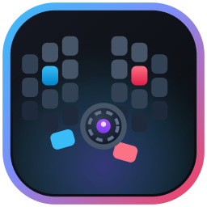

<p align="center">
  
</p>

<h1 align="center">Sofle Studio</h1>

<p align="center">
  <strong>Complete web configurator and Windows companion for the Sofle RGB split keyboard</strong><br>
  Dual-engine per-key lighting, live ZMK Studio keymap editing, and background EN/HE OLED layout monitoring.
</p>

<p align="center">
  
  
  
  
  
</p>

<p align="center">
  <a href="https://adielmag.github.io/sofle-studio/"><strong>🚀 Open Live Configurator</strong></a> ·
  <a href="#quick-start">Quick Start</a> ·
  <a href="#features">Features</a> ·
  <a href="#architecture--transports">Architecture</a>
</p>

---

## Overview

**Sofle Studio** provides an all-in-one control center for Sofle v2 keyboards running [ZMK Firmware](https://zmk.dev/) on nice!nano v2 microcontrollers. It merges two major capabilities into a single unified interface:

1. **Per-Key RGB Configurator**: Direct hardware control over global lighting animations, dual-stop gradients, per-layer key colors, and reactive keypress effects via USB Raw HID.
2. **In-App Keymap Editor**: Full in-browser replacement for ZMK Studio using Web Serial and Protobuf RPC over USB CDC ACM. Live-edit key bindings, manage layers, and save changes to onboard flash without flashing new firmware.
3. **Windows Tray Companion (`MySofleHost`)**: A lightweight Windows background app that sits in your hidden icons, serves the configurator offline in borderless desktop app mode, and actively pushes your Windows keyboard language (**EN** / **HE**), system volume, and time to the Sofle nice!oled screen.

---

## Features

### 🌈 Lighting & RGB Engine
- **9 Global Effects**: Solid, Breathe, Spectrum, Swirl, Wave, Radial, Gradient, Starlight, and None (Typing-Only).
- **Dual-Stop Gradient Editor**: Interactive color stop handles directly on the preview gradient bar, 45° snapping direction dial, and one-click color swap.
- **Per-Layer Key Palette**: Configure every key individually with solid colors, transparent fallthrough, effect inheritance, or blackout.
- **Global Reactive Keypress**: Wave, Ripple, Held, and Color highlight animations triggered live on key strikes.
- **Safe Hardware Limits**: Master brightness capped at firmware-safe maximum (`40%`) to protect battery and controller power rails.

### ⌨️ Keymap Studio (ZMK RPC)
- **Live Binding Edits**: Click any key to inspect and change its behavior (Key Press, Mod-Tap, Momentary Layer, Bluetooth, Media, etc.).
- **Searchable Keycode Picker**: Quick filter over standard HID keyboard, keypad, consumer, and modifier usage tables with checkbox modifiers (`Ctrl`, `Shift`, `Alt`, `Gui`).
- **Layer Management**: Add, remove, rename, and reorder keyboard layers.
- **Persistent Flash Storage**: Test changes in RAM immediately; commit permanently via **Save keymap** or revert with **Discard**.
- **Guided Unlock Banner**: Automatically detects keyboard lock state and provides step-by-step unlock guidance with live auto-load.

### 🪟 Windows Tray Companion (`MySofleHost`)
- **Hidden Icons Tray Presence**: Sits quietly in the notification area with a custom keyboard icon.
- **Active EN / HE OLED Sync**: Monitors the foreground Windows input language and streams layout changes over Raw HID to the keyboard's OLED display in real time.
- **Offline Desktop App Mode**: Serves local assets via an embedded static HTTP server and launches Microsoft Edge or Chrome in `--app` mode (no URL bar, no browser tabs, native desktop feel).
- **Auto-Start**: One-click "Start with Windows" registry autostart toggle in the tray menu.

---

## Quick Start

### Option A: Web App (Any Chromium Browser)

No installation required. Open in Google Chrome, Microsoft Edge, Brave, or Opera:

```bash
# Serve the web directory with any static server:
cd web
python -m http.server 8000
# Open http://localhost:8000 in your browser
```

1. Click **Connect** (or switch to **Keymap** and click **Connect serial port**).
2. Choose your keyboard from the browser permission prompt.
3. If the keyboard is locked, hold <kbd>MO L</kbd> (left thumb cluster) and press <kbd>Studio</kbd> to unlock.

> [!NOTE]
> WebHID and Web Serial require a secure context (`https://` or `http://localhost` / `http://127.0.0.1`).

---

### Option B: Windows Desktop Tray App

Download or clone the repository on Windows:

1. Double-click `Launch-Sofle.bat` (or run `host/MySofleHost/dist/MySofleHost.exe`).
2. Look in the Windows taskbar hidden icons (click the `^` chevron).
3. Click the keyboard icon to launch the standalone configurator window.
4. Language switching (`Alt+Shift` or `Win+Space`) immediately reflects on your keyboard's OLED screen.

---

## Architecture & Transports

```
┌─────────────────────────────────────────────────────────────┐
│                        Sofle Studio                         │
│   ┌───────────────────────────┐ ┌───────────────────────┐   │
│   │    Lighting Tab (HID)     │ │   Keymap Tab (Serial) │   │
│   └─────────────┬─────────────┘ └───────────┬───────────┘   │
└─────────────────┼───────────────────────────┼───────────────┘
                  │ Raw HID (0xFF60 / 0x61)   │ Web Serial (CDC ACM)
                  │ Magic 0x52, Chunks <= 16B │ Protobuf RPC (SOF 0xAB)
                  ▼                           ▼
┌─────────────────────────────────────────────────────────────┐
│                    Sofle Keyboard (ZMK)                     │
│   ┌───────────────────────────┐ ┌───────────────────────┐   │
│   │     rgbpk Engine          │ │      ZMK Studio       │   │
│   │  (29 LEDs/half, NVS flash)│ │ (Keymap, Layers, RPC) │   │
│   └───────────────────────────┘ └───────────────────────┘   │
│                 ▲                                           │
│                 │ Layout Notifications (0xAC: EN=0, HE=1)   │
│   ┌─────────────┴─────────────┐                             │
│   │  MySofleHost Background   │ ◄── Windows Foreground      │
│   │  (Tray & Layout Monitor)  │     Language Hooks          │
│   └───────────────────────────┘                             │
└─────────────────────────────────────────────────────────────┘
```

| Subsystem | Transport | Protocol | Target |
|---|---|---|---|
| **Lighting** | WebHID (`navigator.hid`) | Custom raw HID packet (`0x52`), 16-byte chunked frames | Central half RGB driver (`rgbpk`) |
| **Keymap** | Web Serial (`navigator.serial`) | ZMK Studio Protobuf RPC (`0xAB` SOF, `0xAD` EOF) | ZMK Studio subsystem |
| **Language Sync** | Raw HID (Win32) | `0xAC` layout notifications (`0` = EN, `1` = HE) | `nice-oled` display widget |

---

## Repository Structure

```
sofle-studio/
├── web/                     # Web configurator (Zero build step, vanilla ES modules)
│   ├── index.html           # Main UI container & SVG icon sprites
│   ├── style.css            # Dark mode UI styles & responsive layout
│   ├── app.js               # Lighting application logic & WebHID driver
│   ├── keymap.js            # Keymap editor UI & interactive board renderer
│   ├── picker.js            # Color wheel & gradient dial components
│   ├── icon.svg             # Vector brand icon & favicon
│   └── studio/              # ZMK Studio subsystem
│       ├── pb.js            # Minimal zero-dep Protobuf wire codec & framer
│       ├── client.js        # High-level ZMK Studio RPC client
│       ├── keycodes.js      # HID keyboard & consumer usage dictionaries
│       └── mock.js          # In-memory simulated keyboard for demo mode
├── host/                    # Windows companion app
│   └── MySofleHost/         # .NET 7 WinForms system tray application
│       ├── Program.cs       # Tray context, embedded HTTP server & process supervisor
│       ├── publish.ps1      # Self-contained single-file publisher
│       └── dist/            # Portable runtime binaries (`MySofleHost.exe`)
├── docs/                    # Technical specifications
│   ├── STUDIO.md            # ZMK Studio RPC wire protocol reference
│   └── TRAY_APP.md          # Windows tray companion user guide
└── Launch-Sofle.bat         # Single-click launcher for Windows
```

---

## Testing & Validation

The web app includes an offline test suite for the protobuf codec, HID chunking, and CRC-16 integrity:

```bash
cd web
node test.mjs
```

You can preview and test the complete UI in demo mode without hardware connected:

```
http://localhost:8000/?demo
http://localhost:8000/?demo&view=keymap
```
