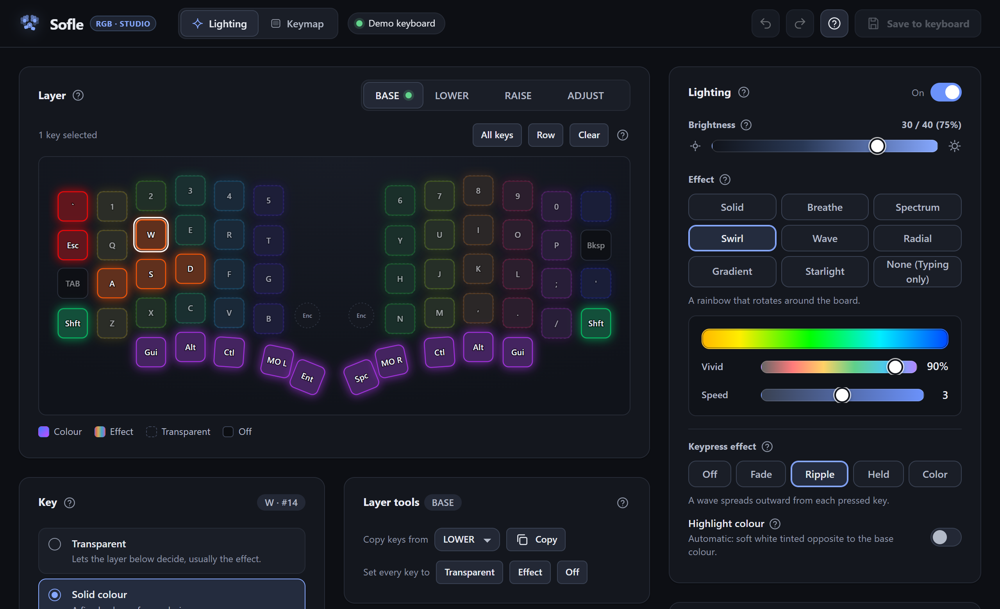
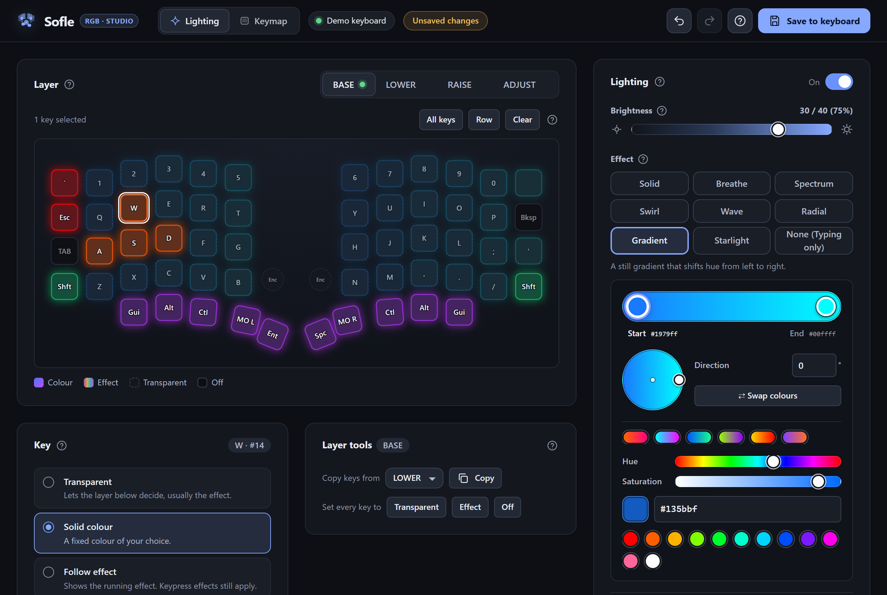
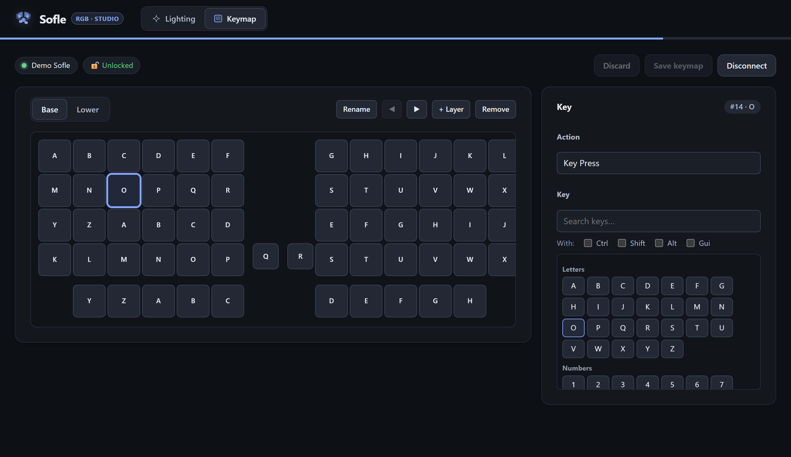

  

<h1 align="center">Sofle Studio</h1>

  <strong>Complete web configurator and Windows companion for the Sofle RGB split keyboard</strong> 
  Dual-engine per-key lighting, live ZMK Studio keymap editing, and background EN/HE OLED layout monitoring.

  
  
  
  
  

  <a href="https://adielmag.github.io/sofle-studio/"><strong>🚀 Open Live Configurator</strong></a> ·
  <a href="#quick-start">Quick Start</a> ·
  <a href="#features">Features</a> ·
  <a href="#try-in-demo-mode">Demo Mode</a> ·
  <a href="#architecture--protocols">Architecture</a>

  

---

## Overview

**Sofle Studio** is an all-in-one control center for Sofle v2 keyboards running [ZMK Firmware](https://zmk.dev/) on nice!nano v2 microcontrollers. It unites hardware lighting and key remapping into a fast, modern web app with an optional Windows background companion:

- **Per-Key RGB Configurator**: Control global animations, dual-stop gradients, per-layer key colors, and reactive keypress effects over WebHID.
- **In-App Keymap Editor**: Full ZMK Studio client over Web Serial. Live-edit key bindings, manage layers, and commit changes directly to onboard flash.
- **Windows Tray Companion (`MySofleHost`)**: Background tray app that synchronizes your Windows keyboard language (**EN** / **HE**) to the nice!oled display and launches the studio in borderless desktop mode.

---

## Features

### 🌈 Per-Key Lighting & RGB Engine

Custom firmware engine (`rgbpk`) providing real-time lighting control without recompiling firmware:

- **9 Global Effects**: Solid, Breathe, Spectrum, Swirl, Wave, Radial, Gradient, Starlight, and Typing-Only.
- **Interactive Dual-Stop Gradient Editor**: Visual color stop handles, 360° direction dial, preset themes (Neon, Fire, Lavender), and color swap.
- **Per-Layer Key Palette**: Paint keys individually with solid colors, transparent fallthrough, effect inheritance, or blackout.
- **Reactive Typing Animations**: Ripple, Wave, Held, and Color highlight animations triggered on keypress.
- **Safe Hardware Limits**: Firmware-enforced 40% master brightness ceiling to protect battery life and power rails.

  

### ⌨️ Keymap Studio (ZMK RPC)

Integrated ZMK Studio client communicating via Web Serial and Protobuf RPC:

- **Live Key Binding**: Click any key to inspect and assign behaviors (Key Press, Mod-Tap, Momentary Layer, Bluetooth, Media, etc.).
- **Searchable Keycode Picker**: Filter standard HID keyboard, keypad, consumer, and modifier keys with one-click modifier flags (`Ctrl`, `Shift`, `Alt`, `Gui`).
- **Layer Management**: Add, remove, rename, and reorder keyboard layers.
- **RAM Preview & Flash Persistence**: Changes apply immediately in RAM. Commit permanently to onboard storage with **Save keymap** or revert with **Discard**.
- **Guided Unlock State**: Live lock detection with step-by-step unlock guidance.

  

### 🪟 Windows Tray Companion (`MySofleHost`)

- **System Tray Presence**: Sits quietly in the notification area with a dedicated keyboard status icon.
- **Active EN / HE OLED Sync**: Monitors Windows foreground input language and streams layout changes over Raw HID to the keyboard's OLED screen.
- **Offline Desktop App Mode**: Serves local files through an embedded micro-server and opens Microsoft Edge or Chrome in `--app` mode (no browser address bar or tabs).
- **Auto-Start**: One-click "Start with Windows" autostart toggle in the tray context menu.

---

## Quick Start

### Option A: Web App (Chromium Browsers)

Works in Chrome, Edge, Brave, or Opera without installing anything:

1. Open [**adielmag.github.io/sofle-studio**](https://adielmag.github.io/sofle-studio/) (or serve `web/` locally: `cd web && python -m http.server 8000`).
2. Click **Connect** (or switch to **Keymap** and click **Connect serial port**).
3. Select your keyboard in the browser prompt.
4. If locked, hold <kbd>MO L</kbd> (left thumb cluster) and tap <kbd>Studio</kbd> to unlock.

> [!NOTE]
> WebHID and Web Serial require a secure context (`https://` or `http://localhost`).

---

### Option B: Windows Desktop Tray App

1. Double-click `Launch-Sofle.bat` (or run `host/MySofleHost/dist/MySofleHost.exe`).
2. Find the keyboard icon in the taskbar hidden icons (chevron `^`).
3. Click the icon to launch the standalone desktop studio window.
4. Switching Windows layout (`Alt+Shift` or `Win+Space`) instantly reflects on the OLED display.

---

## Try in Demo Mode

Test the complete UI directly in your browser without hardware connected:

- 🎨 [**Preview Lighting Configurator**](https://adielmag.github.io/sofle-studio/?demo)
- ⌨️ [**Preview Keymap Studio**](https://adielmag.github.io/sofle-studio/?demo&view=keymap)

---

## Architecture & Protocols

| Subsystem | Transport | Protocol | Description |
|---|---|---|---|
| **Lighting** | WebHID (`navigator.hid`) | Raw HID chunked packets | Hardware RGB controls, animations, and layer palettes (`rgbpk`) |
| **Keymap** | Web Serial (`navigator.serial`) | ZMK Protobuf RPC | Live layer editing, key behaviors, and NVS flash storage |
| **OLED Sync** | Raw HID (Win32) | Background layout notifications | Streams active language (EN/HE) to `nice-oled` display |

Detailed wire specifications and implementation references:

- 📘 [**Raw HID Protocol Reference**](docs/PROTOCOL.md) — Frame formats, command byte tables, CRC integrity, and flash layout.
- 📙 [**ZMK Studio Protocol Reference**](docs/STUDIO.md) — CDC ACM serial transport, Protobuf RPC packet framing, and state machines.
- 📗 [**Windows Companion Guide**](docs/TRAY_APP.md) — Tray application setup, registry autostart, and layout monitoring.

---

## License

MIT License. Designed for the [Sofle RGB](https://github.com/josefadamcik/SofleKeyboard) keyboard running [ZMK Firmware](https://zmk.dev/).
